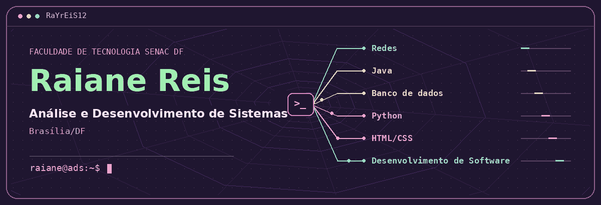

  
  
  

## Sobre mim

Sou estudante de **Análise e Desenvolvimento de Sistemas** na Faculdade de Tecnologia Senac DF. Neste perfil, compartilho projetos acadêmicos de desenvolvimento de software, bancos de dados e redes de computadores.

Minha experiência como assistente administrativa na Drogaria Rosário inclui atendimento ao público, abertura de chamados e apoio com equipamentos. Busco uma oportunidade de **estágio ou posição inicial em TI**, com interesse em desenvolvimento de software, suporte técnico e redes.

## Tecnologias e ferramentas

  

**Visual Studio Code** **AWS**  **Java** · **Spring Boot** · **JavaFX** · **SQL** · **HTML/CSS** · **JavaScript** · **Python (noções)** · **GitHub** · **IntelliJ IDEA**

Em redes, estudo **TCP/IP, DNS, DHCP e planejamento de topologias**.

## Projetos selecionados

| Projeto | O que apresenta | Tecnologias |
| --- | --- | --- |
| [SARA](https://github.com/mardenmartins/projeto.s.a.r.a) | Projeto acadêmico em equipe para rastrear e consultar informações de produtos por QR Code. | HTML, CSS, JavaScript, Supabase e PostgreSQL |
| **Topologia de rede para uma loja de conserto de celulares** | Planejamento da rede entre a recepção e o laboratório técnico. | Redes de computadores |
| **API de Reservas de Salas** | Cadastro, consulta, alteração e exclusão de reservas, com dados em memória. | Java e Spring Boot |
| **ReConecta** | Proposta de negócio social para reaproveitar celulares usados e ampliar o acesso a aparelhos. | Canvas de Modelo de Negócio |

### Projeto em destaque · SARA

Participei do desenvolvimento do **SARA — Sistema Automático de Reconhecimento de Autenticidade**, um projeto acadêmico em equipe. A proposta é permitir o cadastro de produtos e a consulta das informações por QR Code. [Ver o repositório do projeto](https://github.com/mardenmartins/projeto.s.a.r.a).

## Atividade e contato

[Ver minhas contribuições no GitHub](https://github.com/RaYrEiS12#contribution-activity) · [Conversar comigo pelo LinkedIn](https://www.linkedin.com/in/raiane-reis-ads/)
